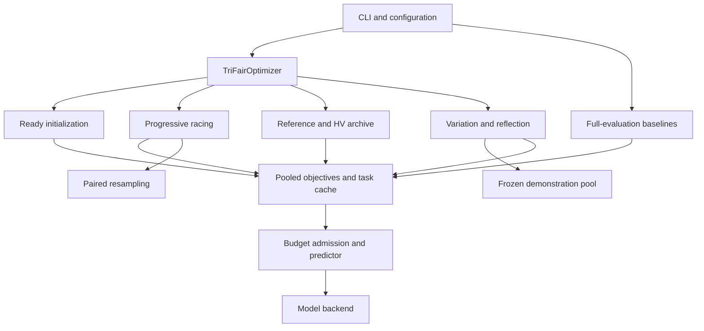

# Current architecture

There is one active Tri-Fair optimizer. It composes responsibility-specific mixins and the shared prompt-search engine; it does not inherit historical v3/v4/v5/v6/v7 optimizer classes.

| Responsibility | Implementation | Contract |
|---|---|---|
| Orchestration / current state | `optimizers/trifair.py` | Initializes one current algorithm; delegates reusable policies |
| Objective aggregation | `search/objectives.py`, `data/task.py` | Recompute nonlinear metrics on pooled cached rows |
| Initialization | `search/initialization.py` | Warm starts and readiness before archive admission |
| Racing | `search/racing.py` | Shared-block comparison, conservative rejection and confirmation |
| Archive / parent selection | `search/archive.py`, `search/selection.py` | Raw pooled vectors, fixed normalization and bounded archive |
| Proposal generation | `search/variation.py`, `reference.py`, `contrastive.py`, `balanced.py`, `mutation.py` | Dataset-aware operators and fallback proposals |
| Additional reflection / demo edits | `search/feedback.py` | Search evidence only; demonstrations only from frozen few-shot pool |
| Paired diagnostics | `search/uncertainty.py` | Identical resample indices for both candidates; no new LLM calls |
| Runtime controls | `runtime/budget.py`, `checkpointing.py` | Pre-call budget admission and restart state |
| Evaluation and reporting | `cli/evaluate.py`, `reporting/summarize.py` | Shared unique-prompt evaluation and frozen validation selection |

The proposal modules are named by responsibility because they are reusable current operators, including fallbacks for invalid meta-model proposals. They are not alternative historical experiment versions.

The refactor preserves ordering, numerical objective operations and stochastic call order. Deterministic before/after checks compare instructions, complete prompts, archive members, scores, and both models' token counters. This is stronger evidence than checking only import success, but it cannot prove equivalence across every real-model response, GPU kernel or interrupted execution.

Source paths and checkpoint class names have changed. Checkpoints are deliberately incompatible with the older bundle; aliases pretending to restore old optimizer state are not provided. Earlier results remain historical evidence and should not be overwritten.
